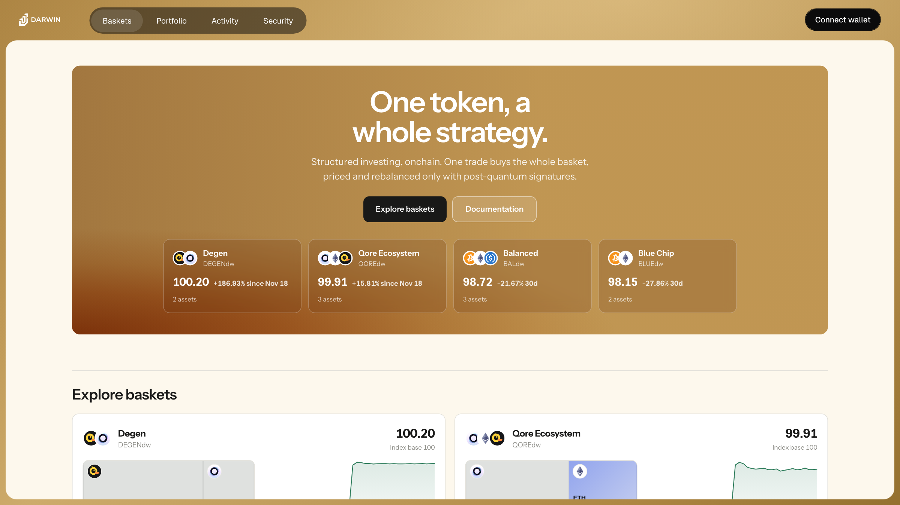
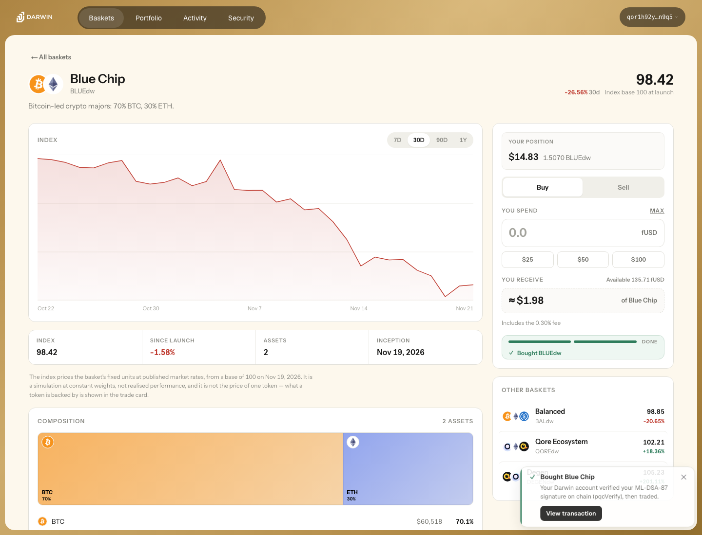

<p align="center"></p>

# Darwin on QoreChain

**Crypto baskets that survive Q-Day.** Buy a whole portfolio as one token. Every price, every
rebalance, every trade and every transaction Darwin sends is signed with ML-DSA-87 (FIPS 204) and
verified by QoreChain, and no Darwin account can act with an ECDSA key alone.

**[Live app](https://darwin.market/qorechain)** ·
**[Verify it yourself](#verify-it-yourself)** ·
**[How it works](#how-it-works)** ·
**[Threat model](docs/AUDIT.md)** ·
**[Findings](docs/TESTING.md#what-the-batteries-found)** ·
**[Latest battery](docs/e2e/account-battery-2026-11-21T133530.md)** ·
**[Docs](https://docs.darwin.market/qorechain)**

Built for **Build Before Q-Day**, the QoreChain Developer Fest, category **Post-Quantum dApp**, on
the `qorechain-diana` testnet. Darwin already runs on Miden mainnet
([app.darwin.market](https://app.darwin.market)); this is its post-quantum port, written during the
fest.

## In one minute

- **4 baskets live** (Blue Chip, Balanced, Qore Ecosystem, Degen): one ERC-20 token each, bought
  and sold for fUSD in one signed message from QoreX.
- **519/519 Darwin transactions** since 2026-11-21 09:12 UTC carry a hybrid secp256k1 + ML-DSA-87
  signature the chain verified (`ops/src/pq-audit.ts`, no key needed to rerun it).
- **0 EVM windows open** on Darwin's five accounts: the chain refuses an ECDSA-only transaction from
  them (on-chain suite, 28/28).
- **Every user trade is checked on chain** by the user's own `DarwinAccount`, which calls `pqcVerify`
  on the owner's 4,627-byte ML-DSA-87 signature; a 6-user battery on production: 45/45 operations,
  36/36 attacks refused, 37/37 signatures re-verified off chain, 0 failures.
- **The QoreChain explorer** shows every kind of Darwin transaction *quantum-safe, verified
  on-chain* (10/10 kinds), and an old ECDSA-only transaction *not quantum-safe*
  ([report](docs/e2e/explorer-2026-11-21T141555.md)).

<table>
<tr>
<td width="50%"></td>
<td width="50%"></td>
</tr>
<tr>
<td align="center">The four baskets, priced by ML-DSA-87 signed rounds</td>
<td align="center">A buy: one message signed in QoreX, checked on chain by the user's account</td>
</tr>
</table>

## Why

| Problem | Why a classical chain fails | What Darwin does |
|---|---|---|
| Whoever sets the price can drain a basket | the oracle key is a secp256k1 key: on Q-Day its private key is derived from its public key | every price round is signed by the reporter's ML-DSA-87 key and checked by `pqcVerify` against the key registered on chain |
| Whoever rebalances trades the vault | a curator's ECDSA signature can be forged the same way | every rebalance and weight change needs the curator's ML-DSA-87 signature, plus a 1% max NAV loss |
| The admin can change anything | `onlyOwner` checks `msg.sender`, an ECDSA key | every admin power takes an ML-DSA-87 signature (`PqcAdmin`); no function grants admin powers by `msg.sender` |
| A user's trade is authorised by its wallet key | an ECDSA signature alone | the user signs in QoreX (secp256k1 + ML-DSA-87); the user's `DarwinAccount` verifies the ML-DSA-87 half on chain before any call |
| The operator's own transactions | an EVM transaction carries ECDSA alone | every Darwin transaction is a `MsgCrossVMCall` hybrid-signed and verified by the chain; no EVM window is open, so ECDSA alone is refused |

## Try it in two minutes

1. Install QoreX and switch it to **Testnet**. Take test QOR and fUSD from the
   [faucet](https://dashboard.qorechain.io/faucet).
2. Open **[darwin.market/qorechain](https://darwin.market/qorechain)**, connect, open a basket, buy.
   The first buy asks for two approvals (the fUSD deposit, then the signed trade); later buys, one.
3. Click *View transaction*: Darwin's transaction page re-verifies your ML-DSA-87 signature in the
   browser and shows that it fails for the next nonce.
4. On the QoreChain explorer, choose **Testnet** first (it opens on mainnet), then open the
   transaction: *Signature security: quantum-safe, verified on-chain*, ML-DSA-87.

## Where the post-quantum stack is used

| Action | Signed by | Verified by |
|---|---|---|
| Oracle price round | reporter, ML-DSA-87 | `DarwinOracle.submit` → `pqcVerify` (`0x…0A01`) against `pqcKeyStatus` (`0x…0A02`) |
| Rebalance (exact trades) | curator, ML-DSA-87 | `DarwinBasket.rebalance`, plus a max NAV loss of 1% |
| Target weights | curator, ML-DSA-87 | `DarwinBasket.setTargetWeights` |
| Every admin action | admin, ML-DSA-87 | `PqcAdmin` |
| User buy, sell, withdraw | the user: QoreX `signArbitrary`, secp256k1 + ML-DSA-87 | QoreSign `verifyMessageWithChain` (both halves) by the relayer, then the user's `DarwinAccount`: `pqcVerify`, single-use nonce, Darwin's contracts only |
| Accounts' allowed targets | admin, ML-DSA-87 | `DarwinAccountFactory.setTarget` |
| Every Darwin transaction (keeper, relayers) | hybrid secp256k1 + ML-DSA-87 | the chain (`pqc_hybrid_verify status=verified`); no EVM window open |
| A user's fUSD deposit | the user in QoreX, hybrid | the chain |
| Account creation | the factory | `PqcAuth.isQuantumSafe`: no account for an owner without a registered, proven ML-DSA-87 key |
| Pause new mints | guardian, hybrid transaction | `msg.sender`; it can never cost a holder anything |

Signatures are domain-separated (tag, chain id, contract, nonce, deadline) and the contracts expose
the exact bytes to sign (`roundMessage`, `rebalanceMessage`, `weightsMessage`, `adminMessage`,
`textFor`), so off-chain signers never re-implement the encoding.

## How it works

```
                QoreX (user)                                   Darwin's server (Vercel)
   signArbitrary: text naming the account,       ┌──────────────────────────────────────────────┐
   nonce, deadline, keccak(calls)                │ relayer (app/src/server/accounts.ts)          │
   secp256k1 + ML-DSA-87  ──────────────────────▶│  QoreSign: both halves vs on-chain keys       │
                                                 │  simulate, then MsgCrossVMCall, hybrid-signed │
   MsgSend fUSD (deposit), hybrid ──────────┐    │  memo unique per message; never sent twice    │
                                            │    │ keeper (app/src/server/keeper.ts)             │
                                            │    │  rounds signed by the reporter (ML-DSA-87)    │
                                            │    │  rebalances signed by the curator (ML-DSA-87) │
                                            │    └───────────────┬──────────────────────────────┘
                                            ▼                    ▼  hybrid MsgCrossVMCall, no EVM window
 qorechain-diana ─────────────────────────────────────────────────────────────────────────────────
   DarwinAccountFactory ─▶ DarwinAccount (one per user, CREATE2)   pqcVerify(owner's key)
                             └─▶ DarwinRouter ─▶ DarwinReserve (oracle-priced inventory)
                                                └▶ DarwinBasket (ERC-20 share, NAV, rebalance: pqcVerify)
   DarwinOracle: submit(round) ─▶ pqcVerify(reporter's key)   PqcAdmin: every admin power ─▶ pqcVerify
```

- **Deposit:** the user sends fUSD to its relayer (one `MsgSend` in QoreX); the relayer converts the
  same amount onto the user's account (`MsgConvertCoin`), credited once (memo
  `darwin deposit <tx>` and a 1 uqor marker found by an indexed search).
- **Trade:** one signed text; the account rebuilds it, verifies the ML-DSA-87 signature, bumps its
  nonce and calls the router. No EVM window, no authz grant, no gas for the user.
- **Withdraw:** one signed text; the account hands the fUSD to the relayer, which returns it to the
  wallet (`MsgConvertERC20`). A withdrawal cut halfway is completed by `settleWithdrawals()`.
- **Prices:** published on demand (before a trade if the last round is over 20 minutes old, when a
  visitor finds it stale, and by a daily cron); the router refuses prices older than 30 minutes.
- **Rebalance:** Mondays 12:05 UTC, curator-signed trades.
- **Native calls leave no EVM logs:** each carries a memo (`darwin round <n>`,
  `darwin rebalance …`, `darwin execute <account> <nonce> <calls hash>`); the app decodes the
  calldata and re-verifies the signature for that number in the browser.

Details: [docs.darwin.market/qorechain](https://docs.darwin.market/qorechain) and
[docs/AUDIT.md](docs/AUDIT.md).

## Verify it yourself

No key is needed for any of this.

**On the explorer** (select **Testnet** first), one transaction of each kind:

| Kind | Transaction |
|---|---|
| Trade through a DarwinAccount (relayer) | [97E9BBFA…](https://explore.qore.network/tx/97E9BBFAA92283417797885DEC3F370BAE5FA97108D1E27F758D1E6CD4FF69A2) |
| Withdrawal from a DarwinAccount (relayer) | [952DC653…](https://explore.qore.network/tx/952DC653C4F88014C5F8BB7C6A6CA239DD81A51D26029F5AA8C0BB774CC08A7D) |
| Withdrawal returned to the wallet (`MsgConvertERC20`) | [A14418C0…](https://explore.qore.network/tx/A14418C013490D65D409AAAA939318CCDFE8BA352B85A2B76A52354244BA206D) |
| Deposit credited (`MsgConvertCoin`) | [51F9FC75…](https://explore.qore.network/tx/51F9FC752FAE3651DD4BC4E8ACB85BBA1100CD3A74727D04B042E16C63187ABC) |
| Deposit sent by a user (`MsgSend`) | [26BC57F0…](https://explore.qore.network/tx/26BC57F05EA2025DB051697A06FF1ACEA0428479F86FC70B08522DB6B72CA6E7) |
| Oracle round (keeper) | [DD087B5F…](https://explore.qore.network/tx/DD087B5FBC67AF814A0435C2E05FE1D864721550DD97241904392F727002491D) |
| Rebalance (keeper) | [D6E94AD4…](https://explore.qore.network/tx/D6E94AD4D2D7CC20AEB93C3CBB52DCE5EBC2B087C0A767ABED78B0D0A19D6E75) |
| Admin call, PQ-admin signed | [0AB1275E…](https://explore.qore.network/tx/0AB1275EFA15376AF92BF25CDC383396CE998836CB9E93C26D1CB31FC027B485) |
| Funds sent by the deployer | [2C121D24…](https://explore.qore.network/tx/2C121D24C3DDF1949D491DEAF122C811D1470D6C17A696E447C42E49D96132E9) |
| Control: an old ECDSA-only EVM transaction, *not quantum-safe* | [D64402E5…](https://explore.qore.network/tx/D64402E52FBD56981BD1FE404EF2F791A9F6EDE2E6A148FD01175E48F0547986) |

**From a terminal** (Node 20+):

```bash
git clone https://github.com/darwinmarket/darwin-qorechain && cd darwin-qorechain

# every transaction of Darwin's five accounts since a date: hybrid-signed and verified by the chain?
cd ops && npm install && npx tsx src/pq-audit.ts 2026-11-21T09:12:00Z && cd ..

# the explorer's verdict on the latest transaction of each kind (Playwright, headless)
cd app && npm install && npx playwright install chromium && node e2e/explorer.mjs && cd ..

# no EVM window on the keeper's account ("found": false); same for the relayers in deployments/diana.json
curl -s https://api-testnet.qore.host/qorechain/pqc/v1/evm_window/qor1yzq84n9uj6fmgzsh7tk88gr7dhrh60u95gpw8p

# the contracts' 110 unit, fuzz and invariant tests
cd contracts && forge test
```

**In the browser:** any trade's page on darwin.market/qorechain (`/tx/<hash>`) rebuilds the text
its owner signed from the calldata and verifies the ML-DSA-87 signature with `@qorechain/pqc`, then
shows it fails for nonce + 1; a round's page does the same for the reporter's signature and the
next round number.

## Evidence

| Suite | What it checks | Latest result |
|---|---|---|
| Contracts (`forge test`) | unit, fuzz, two invariant campaigns (256 runs × 500 calls), 11 DarwinAccount tests | **110/110** |
| On-chain E2E (`ops/src/e2e.ts`) | forged, tampered, replayed, stale signatures refused against the real precompiles; admin, guardian, router, redemption, rebalances; no EVM window on any Darwin account and an ECDSA-only transaction refused; NAV recomputed from holdings | **28/28** ([report](docs/e2e/2026-11-21T1413.md)) |
| Signing audit (`ops/src/pq-audit.ts`) | every transaction of the deployer and the 4 relayers since the windows were closed | **519/519** hybrid-verified |
| Explorer (`app/e2e/explorer.mjs`) | the explorer's verdict on each kind of transaction, plus an ECDSA-only control | **11/11** as expected ([report](docs/e2e/explorer-2026-11-21T141555.md)) |
| DarwinAccount battery (`ops/src/account-battery.ts`) | fresh users on production in parallel: deposits, trades, withdrawals, attacks, double clicks, off-chain re-verification, invariants | **6 users, 45/45 operations, 36/36 attacks refused, 4/4 double clicks sent once, 37/37 signatures re-verified, 0 failures** ([report](docs/e2e/account-battery-2026-11-21T133530.md)); earlier 16 users, 168/168 ([report](docs/e2e/account-battery-2026-11-21T092613.md)) |
| Account path (`ops/src/account-check.ts`) | deposit, buy, sell, withdraw; replay, changed calls, another key, a foreign target, a forged call sent on chain directly | **9/9** |
| Native battery (`ops/src/battery.ts`) | 6 users, cross-VM trades, solvency and NAV invariants | **32/32** ([report](docs/e2e/battery-2026-11-21T0927.md)) |
| Browser E2E (`app/e2e/suite.mjs`) | 27 checks in Chromium with the QoreX test double on production: buys, sells, deposit, withdraw, in-browser re-verification, refusals, Activity, Portfolio, exit | **4 runs in a row, 26/27 each, 0 failures** (1 skip: every vault can fill more than the test wallet holds) ([report](docs/e2e/browser-2026-11-21T140833.md)) |
| Deposit audit (`ops/src/reconcile-deposits.ts`) | every deposit to every relayer against its credit, all pages | every deposit credited once, float 0 |

What the batteries found and how each was fixed: [docs/TESTING.md](docs/TESTING.md).

## Measured

Gas used on qorechain-diana, native lane (`MsgCrossVMCall`, hybrid-verified), medians of every
successful transaction since 2026-11-21 09:12 UTC:

| Operation | Transactions | Median gas | Range |
|---|---|---|---|
| Trade or withdrawal through a DarwinAccount (`pqcVerify` + router) | 232 | 1,741,664 | 690k to 3.17M |
| Oracle round, 4 prices, one ML-DSA-87 signature checked | 4 | 652,444 | 633k to 653k |
| Rebalance, curator-signed | 4 | 980,430 | 980k to 981k |
| Deposit credited (`MsgConvertCoin` + 1 uqor marker) | 55 | 466,458 | 450k to 473k |
| Withdrawal returned (`MsgConvertERC20`) | 33 | 434,627 | 434k to 624k |

The same work on the EVM lane cost ~257k (round), ~389k (rebalance), ~323k (router buy): a
cross-VM call meters the EVM execution at about 2.5×, which is what post-quantum transactions
cost here. Trade latency through the app, signature to confirmation: p50 5.4 s, p90 10.4 s.

Sizes: an ML-DSA-87 signature is 4,627 bytes and a public key 2,592 bytes, as `pqcVerify` takes
them and the explorer reports them. QoreChain's API and EVM endpoints negotiate the hybrid key
exchange X25519MLKEM768 (ML-KEM-768, FIPS 203), found by QoreScan ([CBOM](docs/cbom)).

## Contracts and addresses

qorechain-diana, EVM chain id 9800. Every address and seed: [`deployments/diana.json`](deployments/diana.json).

| Contract | Address |
|---|---|
| Darwin Blue Chip, BLUEdw (70% BTC, 30% ETH) | `0xc35a0eb298693a011d26132eb7f4b8aca8112f92` |
| Darwin Balanced, BALdw (35% BTC, 35% ETH, 30% USD) | `0xfe862c4947626bc9c86bcee12d82153f8286df9a` |
| Darwin Qore Ecosystem, QOREdw (60% QOR, 25% ETH, 15% QWAKK) | `0x86514e17c50265c9ea90d2001bd879b6b724e575` |
| Darwin Degen, DEGENdw (70% QWAKK, 30% QOR) | `0x112d76f9bd9e421228f4b326d13e2ea160e92b74` |
| DarwinOracle | `0xabe07a51e1974d36970b40d3c1c84da37364685f` |
| DarwinReserve | `0x3a87144e2193db059228f5b982ffb2bdf65bc264` |
| DarwinRouter | `0xf402f3ce6505be9ba382ddf0bc53c27c1bd1d018` |
| DarwinAccountFactory | `0x09891b295bf34c6ed6b364e53bcd68e06fc2bd12` |
| WQOR | `0xa140f05ff3fec2d757ae758cddc064e2e386b749` |

| Account | Address | Role |
|---|---|---|
| Deployer, admin, keeper | `qor1yzq84n9uj6fmgzsh7tk88gr7dhrh60u95gpw8p` (`0x20807acc…`) | hybrid rounds, rebalances, admin calls; no EVM window |
| Reporter | `0x6A286f3D805c2bE0d653Ec86c1CaD9598373CB2e` | ML-DSA-87 signer of every round; never sends a transaction |
| Curator | `0xe0BBCcb71b761041B3f3038b3E6cdb392CfbE373` | ML-DSA-87 signer of weights and rebalances; never sends a transaction |
| Relayers (4) | `qor1pzkqj8x…`, `qor1cuvn9me…`, `qor1rsp00u4…`, `qor1ljnamh3…` (full list in `deployments/diana.json`) | submit users' signed messages, credit deposits, return withdrawals; no EVM window |

BTC, ETH and USD are the fest test tokens fBTC, fETH and fUSD; QOR and QWAKK are held as fQOR and
fQWAKK, minted only by the admin's ML-DSA-87 signature and priced by the real markets (QOR from
CoinGecko and MEXC, QWAKK from its native AMM pool). Why: [docs/PRICING.md](docs/PRICING.md).

## Repository map

```
contracts/      Solidity 0.8.28, Foundry
  src/pqc/        PqcAuth (ML-DSA-87 check against the key registry), PqcAdmin (admin by PQ signature)
  src/            DarwinOracle, DarwinReserve, DarwinBasket, DarwinRouter, WQOR
  src/account/    DarwinAccount, DarwinAccountFactory: each user's account, obeying its ML-DSA-87 key
app/            Next.js: the app at darwin.market/qorechain
  src/server/     accounts.ts (relayer), keeper.ts (rounds, rebalances), chain.ts (writeNative, sendNative)
  src/lib/qore/   chain reads, QoreX, in-browser verification (verify.ts), native call decoding
  e2e/            suite.mjs (browser), explorer.mjs (explorer verdicts)
ops/            TypeScript operations and test suites: deploy, keeper, e2e, batteries, pq-audit
docs/           AUDIT (threat model), TESTING (findings), PRICING, cbom, e2e reports
docs-site/      the documentation site at docs.darwin.market/qorechain
deployments/    diana.json: every address, role and seed
llms.txt        this project in one page, for agents
```

## Honest scope

- **Testnet only.** fBTC, fETH, fUSD, fQOR and fQWAKK have no value; the mnemonic used here must
  never touch mainnet.
- **Prices come from off-chain markets**, signed by one reporter key; the oracle refuses moves over
  15% a round, stale rounds and out-of-order rounds, but trusts the reporter within those bounds.
- **The reserve is a market maker at oracle prices**, managed by the team; capacity is bounded by
  its inventory (the app refuses buys above it).
- **The relayer is trusted for liveness**, not for funds: it cannot change or replay a signed
  message, but it can refuse or delay one, and it holds fUSD for one transaction during a deposit
  or a withdrawal.
- **Two kinds of transaction still need the EVM lane**: a contract creation and a call carrying QOR
  value (a cross-VM call can do neither). Used at deployment only; none since 2026-11-21.
- **Shares bought before DarwinAccounts** are sold through the original path (an EVM window the
  user opens in QoreX and a 24-hour authz grant).
- **The two-stage QCAI audit** is to be run by the team on the dashboard; our own review and its
  fixes are in [docs/AUDIT.md](docs/AUDIT.md).

## Run it

Requirements: Foundry, Node 20+.

```bash
git clone --recursive https://github.com/darwinmarket/darwin-qorechain && cd darwin-qorechain
cd contracts && forge test && cd ..                    # 110 tests, mock precompiles locally
cd app && npm install && npm run dev                   # http://localhost:3032, against the live testnet
```

Operating a deployment (testnet-only mnemonic in `QORE_MNEMONIC` or
`~/.config/qorechain/testnet.mnemonic`, never committed): `ops/` has `status`, `fund`, `window`,
`deploy`, `keeper`, `e2e`, `account-battery`, `pq-audit`; see
[docs.darwin.market/qorechain/developers/ops](https://docs.darwin.market/qorechain/developers/ops).
The browser suite: `cd app && APP_URL=https://darwin.market/qorechain node e2e/suite.mjs`.

## Docs

- [docs.darwin.market/qorechain](https://docs.darwin.market/qorechain): how it works, the chain
  integration, the protocol, security and verification, developers.
- [docs/AUDIT.md](docs/AUDIT.md): threat model, where each `pqcVerify` and `pqcKeyStatus` call
  sits, our own review.
- [docs/TESTING.md](docs/TESTING.md): every suite, and what each battery found.
- [docs/PRICING.md](docs/PRICING.md): price sources, capacity.
- [docs/cbom](docs/cbom): the CycloneDX CBOM, a DORA mapping, crypto agility.
- [AI_USAGE.md](AI_USAGE.md): how AI was used.

## Credits

- The app's visual shell is forked from Darwin's own mainnet front
  (`darwinmarket/darwin-app-mainnet`, same team); its Miden data layer was replaced by QoreChain.
- QoreChain kits (Apache-2.0, QoreChain Association): `@qorechain/sdk`, `@qorechain/evm`,
  `@qorechain/qoresign`, `@qorechain/pqc` (built on `@noble/post-quantum`, MIT), `@qorechain/react`,
  `@qorechain/wallet-adapter`, `@qorechain/qorex-wallet-mock`, `@qorechain/qore-cli`,
  `@qorechain/mcp`, `@qorechain/qorescan`.
- OpenZeppelin Contracts (MIT); forge-std (MIT/Apache-2.0); viem (MIT); Next.js and React (MIT);
  TanStack Query (MIT); Playwright (Apache-2.0); `@cosmjs/stargate` (Apache-2.0).
- Market data: CoinGecko and MEXC (QOR), Yahoo Finance and four spot APIs (BTC, ETH).
- Logos: QOR from the QoreChain brand pack; QWAKK's mark is relayed from qwakk.fun at runtime and
  not redistributed here.

## Licence

MIT, see [LICENSE](LICENSE).
