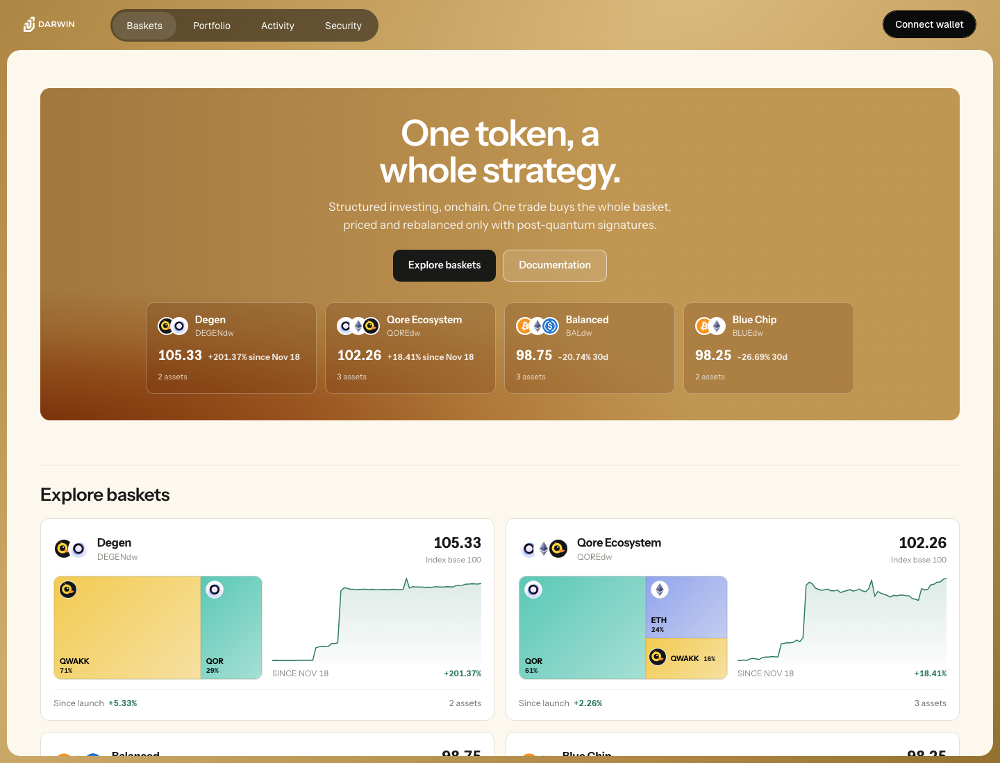
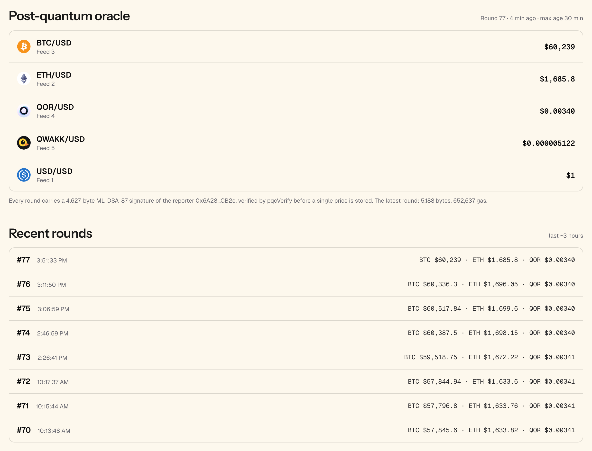
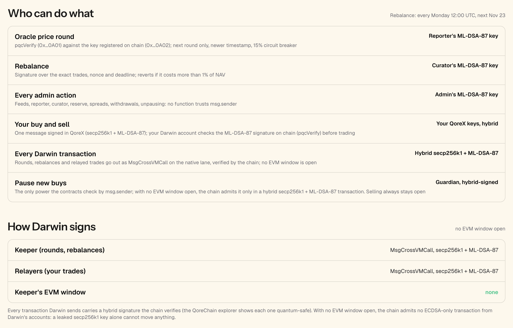
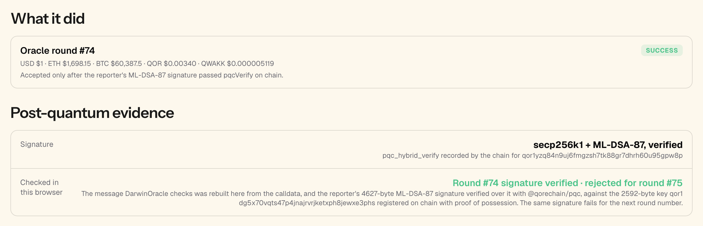
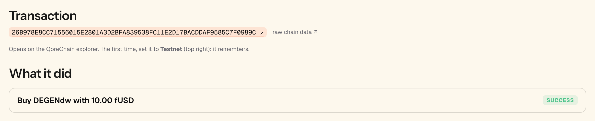
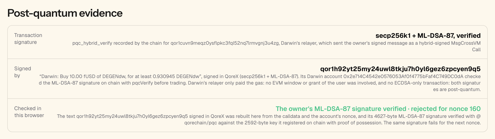
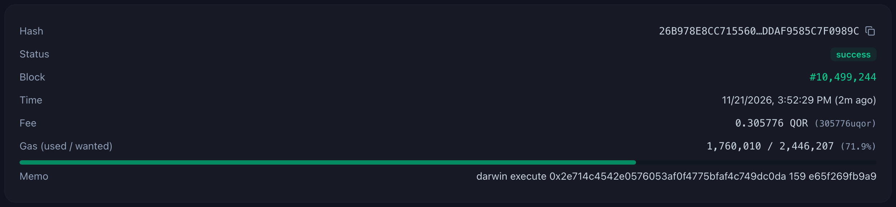
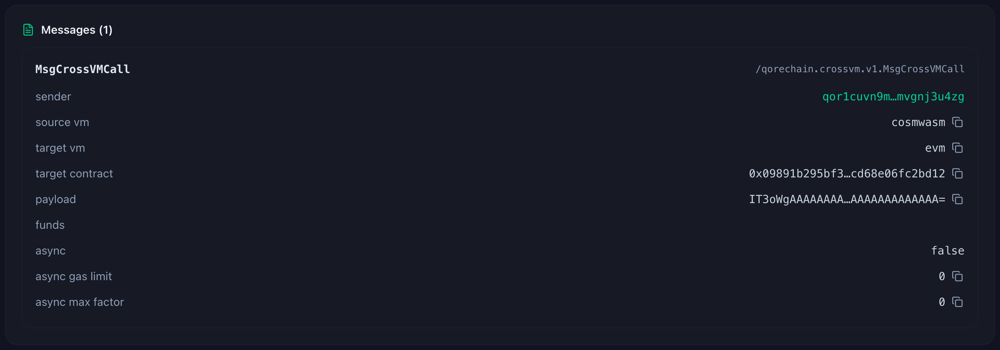
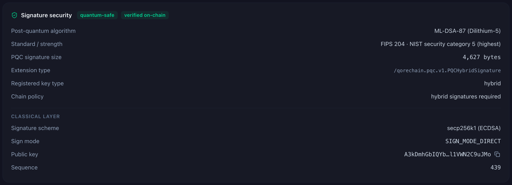

# Darwin on QoreChain

[](https://build.qorechain.io/p/darwin)

> One token, a whole crypto portfolio, and not a single key a quantum computer could break.

Darwin sells crypto baskets: buy Blue Chip, Balanced, Qore Ecosystem or Degen and you hold one
ERC-20 token backed by the coins inside it. This repository is Darwin's port to QoreChain, written
during **Build Before Q-Day** (QoreChain Developer Fest, category **Post-Quantum dApp**) on the
`qorechain-diana` testnet. The original runs on Miden mainnet at
[app.darwin.market](https://app.darwin.market).

The app is live at **[darwin.market/qorechain](https://darwin.market/qorechain)** (QoreX,
testnet), with its documentation at **[docs.darwin.market/qorechain](https://docs.darwin.market/qorechain)**.
Jurors in a hurry: [the numbers](#the-numbers), then [check our claims](#check-our-claims).


## Contents

1. [The numbers](#the-numbers)
2. [Five keys, five ways to lose a basket](#five-keys-five-ways-to-lose-a-basket)
3. [A trade, from click to chain](#a-trade-from-click-to-chain)
4. [The proof, on screen](#the-proof-on-screen)
5. [Check our claims](#check-our-claims)
6. [What post-quantum costs here](#what-post-quantum-costs-here)
7. [Deployment](#deployment)
8. [The code](#the-code)
9. [Limits](#limits)
10. [More](#more)

## The numbers

Measured on 2026-11-21 on qorechain-diana; each one is rerun by a script named in
[Check our claims](#check-our-claims).

| | |
|---|---|
| Darwin transactions with a hybrid secp256k1 + ML-DSA-87 signature verified by the chain, since the EVM windows were closed (2026-11-21 09:12 UTC) | **519 / 519** |
| EVM windows open on Darwin's five accounts (keeper and four relayers) | **0**: the chain refuses an ECDSA-only transaction from them |
| Kinds of Darwin transaction the QoreChain explorer shows *quantum-safe, verified on-chain* | **10 / 10** (an old ECDSA-only control: *not quantum-safe*) |
| Contract tests (unit, fuzz, invariant) | **110 / 110** |
| On-chain end-to-end checks against the real `pqcVerify` and `pqcKeyStatus` | **28 / 28** |
| Production battery, users trading in parallel | **45 / 45** operations, **36 / 36** attacks refused, **0** failures |
| Browser suite on production | **4 runs in a row**, 26 / 27 each, 0 failures |
| Size of the ML-DSA-87 signature `pqcVerify` checks for every trade | **4,627 bytes** |

## Five keys, five ways to lose a basket

A basket protocol is drained by whoever holds one of five keys. On Q-Day, a quantum computer derives
a secp256k1 private key from its public key, so each of them must be something else.

| Key | What a thief could do | On a classical chain | On Darwin |
|---|---|---|---|
| **The price reporter** | publish a false price and buy the basket for nothing | an ECDSA-signed oracle | every round is signed by the reporter's ML-DSA-87 key; `DarwinOracle.submit` calls `pqcVerify` (`0x…0A01`) against the key registered on chain (`pqcKeyStatus`, `0x…0A02`); moves over 15% a round are refused |
| **The curator** | rebalance the vault into worthless trades | an ECDSA-signed rebalance | rebalances and target weights need the curator's ML-DSA-87 signature (`DarwinBasket.rebalance`, `setTargetWeights`), and a rebalance may not lose more than 1% of NAV |
| **The admin** | change parameters, mint, move the reserve | `onlyOwner`, i.e. `msg.sender`, an ECDSA key | every admin power takes an ML-DSA-87 signature (`PqcAdmin`); no function grants admin powers by `msg.sender` |
| **The user's wallet** | trade or withdraw the user's holdings | an ECDSA transaction | the user signs a text in QoreX (secp256k1 + ML-DSA-87); the user's own `DarwinAccount` rebuilds it and checks the ML-DSA-87 half with `pqcVerify` before any call, once (nonce), to Darwin's contracts only |
| **Darwin's own accounts** (keeper, relayers) | send any call those accounts may send | an EVM transaction carries ECDSA alone | every Darwin transaction is a `MsgCrossVMCall` hybrid-signed and verified by the chain; no EVM window is open, so ECDSA alone is refused |

What is left classical: the guardian may pause new mints with a hybrid transaction (checked by
`msg.sender`), a power that can never cost a holder anything. Every signature is domain-separated
(tag, chain id, contract, nonce, deadline), and the contracts publish the exact bytes to sign
(`roundMessage`, `rebalanceMessage`, `weightsMessage`, `adminMessage`, `textFor`).

## A trade, from click to chain

**1. Pick a basket.** Prices come from rounds the reporter signs with ML-DSA-87. They are published
on demand: before a trade if the last round is over 20 minutes old, when a visitor finds it stale,
and by a daily cron. The router refuses prices older than 30 minutes.



**2. Sign once in QoreX.** Install QoreX, switch it to **Testnet**, take QOR and fUSD from the
[faucet](https://dashboard.qorechain.io/faucet), open a basket and buy. QoreX signs a plain text
(`signArbitrary`, secp256k1 + ML-DSA-87):

```
Darwin: Buy 2.00 fUSD of BLUEdw, for at least 0.2 BLUEdw

Darwin account 0x<your account>
nonce 12
valid until 1795270000
calls 0x<keccak256(abi.encode(calls))>
```

The first buy also asks to approve a deposit: a `MsgSend` of fUSD to Darwin's relayer, which puts
the same amount on your account (`MsgConvertCoin`) and marks it credited once.

**3. Darwin's relayer checks, then sends.** It verifies both halves against your keys on chain
(QoreSign `verifyMessageWithChain`), simulates the call, and sends it as a `MsgCrossVMCall` it
hybrid-signs, paying the gas. Its memo is unique to your message
(`darwin execute <account> <nonce> <calls hash>`), so it is never sent twice, even after a retry or
a double click.

**4. Your account checks again, on chain.** `DarwinAccountFactory` creates your account on your
first action (only for a registered, proven ML-DSA-87 key) and calls it. The account rebuilds the
text, runs `pqcVerify`, bumps its nonce and calls the router, which buys each component from the
reserve at oracle prices and mints your shares.


**5. Look at the evidence.** *View transaction* opens Darwin's transaction page: it rebuilds the
text from the calldata, verifies your ML-DSA-87 signature in the browser with `@qorechain/pqc`, and
shows it fails for the next nonce. On the QoreChain explorer (choose **Testnet** first), the same
transaction reads *Signature security: quantum-safe, verified on-chain*, ML-DSA-87.

Selling is the same message with `sell`. Withdrawing is one signed message: your account hands the
fUSD to the relayer, which returns it to your wallet (`MsgConvertERC20`); one cut halfway is
completed by `settleWithdrawals()`. Rebalances run on Mondays at 12:05 UTC with curator-signed
trades.

```
 QoreX ── signed text ──▶ relayer (app/src/server/accounts.ts) ── hybrid MsgCrossVMCall ──┐
 QoreX ── MsgSend fUSD ─▶ relayer ── MsgConvertCoin ───────────────────────────────────┐   │
 keeper (app/src/server/keeper.ts) ── hybrid MsgCrossVMCall: rounds, rebalances ──┐    │   │
                                                                                 ▼    ▼   ▼
 qorechain-diana   DarwinOracle ◀── pqcVerify(reporter)     DarwinAccountFactory ─▶ DarwinAccount
                   DarwinBasket ◀── pqcVerify(curator)        pqcVerify(owner) ─▶ DarwinRouter
                   PqcAdmin     ◀── pqcVerify(admin)            ─▶ DarwinReserve ─▶ DarwinBasket
```

A cross-VM call leaves no EVM log, so each Darwin transaction names itself in its memo
(`darwin round <n>`, `darwin rebalance …`, `darwin execute …`) and the app decodes the calldata,
re-verifying the signature for that number. Full design: [docs/AUDIT.md](docs/AUDIT.md) and
[docs.darwin.market/qorechain](https://docs.darwin.market/qorechain).

## The proof, on screen

The app does not ask to be trusted: it shows where each signature is, who made it, and checks it
again in your browser. Below, the Security tab, then one real price round, then one real trade
([`26B978E8…`](https://darwin.market/qorechain/tx/26B978E8CC71556015E2801A3D2BFA839538FC11E2D17BACDDAF9585C7F0989C)),
first as Darwin shows it, then as QoreChain's own explorer shows it. All taken on production on
2026-11-21 by [`app/e2e/readme-shots.mjs`](app/e2e/readme-shots.mjs).

### The Security tab: what the prices are, and who signed them



Every price the baskets use, read from `DarwinOracle` on chain, with the round it came from. Each
round carries a 4,627-byte ML-DSA-87 signature of the reporter, checked by `pqcVerify` before a
single price is stored (652k gas for the latest one). The list below it is the oracle's history,
each row linking to its transaction page.



*Who can do what* is the whole permission model on one screen: each power, the key it needs, and
what the contract checks. *How Darwin signs* is read live from the chain: the keeper and the
relayers send `MsgCrossVMCall` with a hybrid signature, and the keeper's EVM window is **none**, so
a secp256k1 key alone cannot send anything for Darwin.

### A price round, verified again in your browser



Round #74, opened from the Security tab. The page decodes the prices from the calldata (a
cross-VM call leaves no EVM log), shows the hybrid signature the chain recorded for the keeper's
transaction, then rebuilds the exact message `DarwinOracle` checks and verifies the reporter's
ML-DSA-87 signature with `@qorechain/pqc`, against the key the reporter registered on chain. It
then checks the same signature against round #75 and shows it fails: the signature is bound to
this round and no other.

### One real trade, as Darwin shows it





A buy of 10 fUSD of Degen. The three lines of *Post-quantum evidence* are the three layers of the
trade:

1. **Transaction signature**: the relayer sent it as a hybrid-signed `MsgCrossVMCall`; the chain
   recorded `pqc_hybrid_verify` for that account.
2. **Signed by**: the user, whose words are quoted ("Darwin: Buy 10.00 fUSD of DEGENdw, for at
   least 0.930945 DEGENdw"), signed in QoreX with secp256k1 and ML-DSA-87. The user's Darwin
   account checked the ML-DSA-87 half on chain with `pqcVerify` before trading; the relayer only
   paid the gas.
3. **Checked in this browser**: the page rebuilt that text from the calldata and the account's
   nonce, verified the 4,627-byte signature against the user's 2,592-byte registered key, and
   showed it fails for the next nonce (160): it authorises this trade once.

### The same trade, as QoreChain's explorer shows it



The chain's view, independent of Darwin. The memo names the message: the user's account, its nonce
(159) and the first 12 hex digits of the calls' hash, which is how the relayer makes sure it never
sends a message twice.



One message: a `MsgCrossVMCall` from Darwin's relayer to `0x09891b29…` (`DarwinAccountFactory`),
whose payload is `execute(owner, calls, summary, deadline, pqSignature)`: the user's signed calls
and their ML-DSA-87 signature.



*Signature security: quantum-safe, verified on-chain.* ML-DSA-87 (FIPS 204, NIST category 5),
4,627 bytes, on top of the secp256k1 layer; the chain's policy requires the hybrid. Every kind of
Darwin transaction reads the same way ([report](docs/e2e/explorer-2026-11-21T141555.md)).

## Check our claims

Every claim, its proof, and how to rerun it. Nothing below needs a key.

| Claim | Proof | Rerun |
|---|---|---|
| Every Darwin transaction is hybrid-signed and verified by the chain | 519/519 since 2026-11-21 09:12 UTC | `cd ops && npm install && npx tsx src/pq-audit.ts 2026-11-21T09:12:00Z` |
| The explorer agrees, for every kind of transaction | 11/11 as expected ([report](docs/e2e/explorer-2026-11-21T141555.md)) | `cd app && npm install && npx playwright install chromium && node e2e/explorer.mjs` |
| No Darwin account holds an EVM window | `"found": false` for the keeper; the relayers' windows were closed | `curl -s https://api-testnet.qore.host/qorechain/pqc/v1/evm_window/qor1yzq84n9uj6fmgzsh7tk88gr7dhrh60u95gpw8p` |
| The contracts refuse forged, tampered, replayed and stale signatures | 110/110 tests | `cd contracts && forge test` |
| Same, against the real precompiles, and the chain refuses ECDSA alone | 28/28 ([report](docs/e2e/2026-11-21T1413.md)) | `cd ops && npm run e2e` (team key) |
| Users trading at once break nothing | 6 users on production: 45/45 operations, 36/36 attacks refused, 4/4 double clicks executed once, 37/37 signatures re-verified ([report](docs/e2e/account-battery-2026-11-21T133530.md)); earlier 16 users, 168/168 ([report](docs/e2e/account-battery-2026-11-21T092613.md)) | `cd ops && npx tsx src/account-battery.ts 6 3 <index>` (team key) |
| The app works end to end | 4 runs in a row on production, 26/27 each, 0 failures ([report](docs/e2e/browser-2026-11-21T140833.md)) | `cd app && APP_URL=https://darwin.market/qorechain node e2e/suite.mjs` |
| Every deposit is credited once | float 0 on every relayer | `cd ops && npx tsx src/reconcile-deposits.ts` |

One transaction of each kind, to open on [explore.qore.network](https://explore.qore.network)
(select **Testnet** first): a trade
[97E9BBFA…](https://explore.qore.network/tx/97E9BBFAA92283417797885DEC3F370BAE5FA97108D1E27F758D1E6CD4FF69A2),
a withdrawal
[952DC653…](https://explore.qore.network/tx/952DC653C4F88014C5F8BB7C6A6CA239DD81A51D26029F5AA8C0BB774CC08A7D)
and its return
[A14418C0…](https://explore.qore.network/tx/A14418C013490D65D409AAAA939318CCDFE8BA352B85A2B76A52354244BA206D),
a deposit
[26BC57F0…](https://explore.qore.network/tx/26BC57F05EA2025DB051697A06FF1ACEA0428479F86FC70B08522DB6B72CA6E7)
and its credit
[51F9FC75…](https://explore.qore.network/tx/51F9FC752FAE3651DD4BC4E8ACB85BBA1100CD3A74727D04B042E16C63187ABC),
an oracle round
[DD087B5F…](https://explore.qore.network/tx/DD087B5FBC67AF814A0435C2E05FE1D864721550DD97241904392F727002491D),
a rebalance
[D6E94AD4…](https://explore.qore.network/tx/D6E94AD4D2D7CC20AEB93C3CBB52DCE5EBC2B087C0A767ABED78B0D0A19D6E75),
an admin call
[0AB1275E…](https://explore.qore.network/tx/0AB1275EFA15376AF92BF25CDC383396CE998836CB9E93C26D1CB31FC027B485),
and, for contrast, an old ECDSA-only transaction
[D64402E5…](https://explore.qore.network/tx/D64402E52FBD56981BD1FE404EF2F791A9F6EDE2E6A148FD01175E48F0547986)
that the explorer calls *not quantum-safe*.

What the tests found along the way, and how each was fixed: [docs/TESTING.md](docs/TESTING.md#what-the-batteries-found).

## What post-quantum costs here

Gas used on the native lane (hybrid `MsgCrossVMCall`), medians of every successful transaction
since 2026-11-21 09:12 UTC:

| Operation | Transactions | Median gas | Same work on the EVM lane |
|---|---|---|---|
| Trade or withdrawal through a DarwinAccount (`pqcVerify` + router) | 232 | 1,741,664 | ~323k (router buy alone) |
| Oracle round, 4 prices, one ML-DSA-87 signature checked | 4 | 652,444 | ~257k |
| Rebalance, curator-signed | 4 | 980,430 | ~389k |
| Deposit credited (`MsgConvertCoin` + 1 uqor marker) | 55 | 466,458 | |
| Withdrawal returned (`MsgConvertERC20`) | 33 | 434,627 | |

A cross-VM call meters the EVM execution at about 2.5×: that is the price of transactions no ECDSA
key can forge. Trade latency, signature to confirmation, through the app: p50 5.4 s, p90 10.4 s.
An ML-DSA-87 public key is 2,592 bytes and a signature 4,627 bytes. QoreChain's API and EVM
endpoints negotiate the hybrid key exchange X25519MLKEM768 (ML-KEM-768, FIPS 203), found by
QoreScan ([CBOM](docs/cbom)).

## Deployment

qorechain-diana, EVM chain id 9800; every address, role and seed is in
[`deployments/diana.json`](deployments/diana.json).

| Baskets | Holds | Address |
|---|---|---|
| Darwin Blue Chip, BLUEdw | 70% BTC, 30% ETH | `0xc35a0eb298693a011d26132eb7f4b8aca8112f92` |
| Darwin Balanced, BALdw | 35% BTC, 35% ETH, 30% USD | `0xfe862c4947626bc9c86bcee12d82153f8286df9a` |
| Darwin Qore Ecosystem, QOREdw | 60% QOR, 25% ETH, 15% QWAKK | `0x86514e17c50265c9ea90d2001bd879b6b724e575` |
| Darwin Degen, DEGENdw | 70% QWAKK, 30% QOR | `0x112d76f9bd9e421228f4b326d13e2ea160e92b74` |

| Contracts | Address |
|---|---|
| DarwinOracle | `0xabe07a51e1974d36970b40d3c1c84da37364685f` |
| DarwinReserve | `0x3a87144e2193db059228f5b982ffb2bdf65bc264` |
| DarwinRouter | `0xf402f3ce6505be9ba382ddf0bc53c27c1bd1d018` |
| DarwinAccountFactory | `0x09891b295bf34c6ed6b364e53bcd68e06fc2bd12` |
| WQOR | `0xa140f05ff3fec2d757ae758cddc064e2e386b749` |

| Accounts | Address | Does |
|---|---|---|
| Deployer, admin, keeper | `qor1yzq84n9uj6fmgzsh7tk88gr7dhrh60u95gpw8p` (`0x20807acc…`) | hybrid rounds, rebalances, admin calls |
| Reporter | `0x6A286f3D805c2bE0d653Ec86c1CaD9598373CB2e` | signs every round (ML-DSA-87); sends nothing |
| Curator | `0xe0BBCcb71b761041B3f3038b3E6cdb392CfbE373` | signs weights and rebalances (ML-DSA-87); sends nothing |
| Relayers (4) | `qor1pzkqj8x…`, `qor1cuvn9me…`, `qor1rsp00u4…`, `qor1ljnamh3…` | submit users' signed messages, credit deposits, return withdrawals |

BTC, ETH and USD are the fest test tokens fBTC, fETH and fUSD; QOR and QWAKK are held as fQOR and
fQWAKK, minted only by the admin's ML-DSA-87 signature and priced by the real markets (QOR from
CoinGecko and MEXC, QWAKK from its native AMM pool). Why: [docs/PRICING.md](docs/PRICING.md).

## The code

```
contracts/      Solidity 0.8.28, Foundry
  src/pqc/        PqcAuth (ML-DSA-87 check against the key registry), PqcAdmin (admin by PQ signature)
  src/            DarwinOracle, DarwinReserve, DarwinBasket, DarwinRouter, WQOR
  src/account/    DarwinAccount, DarwinAccountFactory
app/            Next.js, the app at darwin.market/qorechain
  src/server/     accounts.ts (relayer), keeper.ts (rounds, rebalances), chain.ts (hybrid sends)
  src/lib/qore/   chain reads, QoreX, in-browser verification (verify.ts), native call decoding
  e2e/            suite.mjs (browser), explorer.mjs (explorer verdicts)
ops/            deployment, keeper, on-chain suites, batteries, pq-audit
docs/           AUDIT (threat model), TESTING (findings), PRICING, cbom, e2e reports
docs-site/      docs.darwin.market/qorechain
llms.txt        the project in one page, for agents
```

To run it (Foundry, Node 20+):

```bash
git clone --recursive https://github.com/darwinmarket/darwin-qorechain && cd darwin-qorechain
cd contracts && forge test && cd ..          # 110 tests, mock precompiles locally
cd app && npm install && npm run dev         # http://localhost:3032, against the live testnet
```

Operating a deployment needs the testnet mnemonic (`QORE_MNEMONIC` or
`~/.config/qorechain/testnet.mnemonic`, never committed); `ops/` has `status`, `fund`, `window`,
`deploy`, `keeper`, `e2e`, `account-battery`, `pq-audit`. See
[docs.darwin.market/qorechain/developers/ops](https://docs.darwin.market/qorechain/developers/ops).

## Limits

- **Testnet only.** The tokens have no value; the mnemonic used here must never touch mainnet.
- **One reporter key signs prices** from off-chain markets; the oracle bounds it (15% a round,
  freshness, order) but trusts it within those bounds.
- **The reserve is a market maker at oracle prices**, stocked by the team; the app refuses buys
  above its inventory.
- **The relayer is trusted for liveness, not funds.** It cannot change or replay a signed message;
  it can delay one, and holds fUSD for one transaction during a deposit or a withdrawal.
- **Contract creation and calls carrying QOR still need the EVM lane** (a cross-VM call can do
  neither): used at deployment only, none since 2026-11-21.
- **Shares bought before DarwinAccounts** are sold through the original path: an EVM window the
  user opens in QoreX and a 24-hour authz grant.
- **The two-stage QCAI audit** is to be run by the team; our own review and its fixes are in
  [docs/AUDIT.md](docs/AUDIT.md).

## More

- Documentation: [docs.darwin.market/qorechain](https://docs.darwin.market/qorechain).
- [docs/AUDIT.md](docs/AUDIT.md) (threat model, every `pqcVerify` call),
  [docs/TESTING.md](docs/TESTING.md) (every suite, every finding),
  [docs/PRICING.md](docs/PRICING.md), [docs/cbom](docs/cbom), [AI_USAGE.md](AI_USAGE.md).
- Credits: the visual shell is forked from Darwin's mainnet front
  (`darwinmarket/darwin-app-mainnet`, same team). QoreChain kits (Apache-2.0): `@qorechain/sdk`,
  `evm`, `qoresign`, `pqc` (on `@noble/post-quantum`, MIT), `react`, `wallet-adapter`,
  `qorex-wallet-mock`, `qore-cli`, `mcp`, `qorescan`. OpenZeppelin, forge-std, viem, Next.js,
  React, TanStack Query, Playwright, `@cosmjs/stargate`. Market data: CoinGecko, MEXC, Yahoo
  Finance and four spot APIs. QOR's logo from the QoreChain brand pack; QWAKK's mark is relayed
  from qwakk.fun at runtime, not redistributed.
- Licence: MIT, see [LICENSE](LICENSE).
